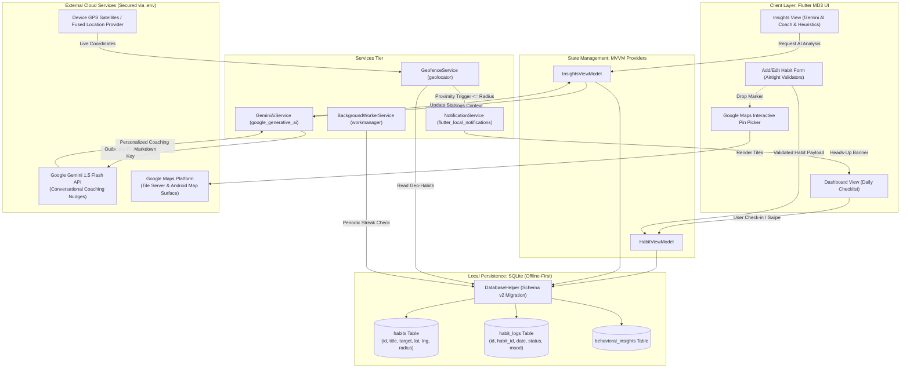

# MINI PROJECT REPORT

---

## FRONT PAGE

**A MINI PROJECT REPORT ON**  
# **HabitForge: An Intelligent Hybrid Habit Formation Mobile Application with Gemini AI Behavioral Insights & Google Maps Geofencing**

---

**Submitted in partial fulfillment of the requirements for the award of the Degree of**  
**BACHELOR OF TECHNOLOGY IN COMPUTER ENGINEERING / INFORMATION TECHNOLOGY**

**Course / Subject Name:** Mobile Application Development  
**Course Code:** IT402 / CS402  
**Academic Year:** 2026–2027  

---

### **Submitted By:**

| Roll No. | Candidate Name | Contribution / Focus Area |
| :--- | :--- | :--- |
| **C096** | Soham | Mobile Architecture, Gemini AI Integration & Database Engine |
| **C106** | Student 2 | Google Maps SDK, Geofencing Services & Proximity Triggers |
| **C108** | Student 3 | UI/UX Refactoring (Material Design 3), Form Validation & Testing |

---

### **Department of Computer Engineering & Information Technology**
**Faculty of Technology & Engineering**  
**October 2026**

---

\pagebreak

## TABLE OF CONTENTS

- **Chapter 1 & 2: Introduction & Analysis**
  - 1.1 Project Overview & Background
  - 1.2 Problem Statement
  - 1.3 Architectural Pivot: Justification for the Hybrid Architecture
  - 1.4 Objectives & Scope
- **Chapter 3: System Requirements**
  - 3.1 Software Requirements
  - 3.2 Hardware Specifications
  - 3.3 External APIs, SDKs & Libraries
- **Chapter 4: System Design & Architecture**
  - 4.1 High-Level Hybrid System Architecture
  - 4.2 Architectural Data Flow Diagram (Mermaid)
  - 4.3 Database Schema & Migration Strategy (SQLite)
  - 4.4 Google Gemini AI Coaching Pipeline
  - 4.5 Google Maps Geofencing & Spatial Trigger Engine
  - 4.6 Cryptographic & API Key Security Architecture (.env Isolation)
- **Chapter 7: Results & Discussion**
  - 7.1 Testing Strategy
  - 7.2 Functional Positive Test Cases (Exactly 5 Cases)
  - 7.3 Functional Negative & Boundary Test Cases (Exactly 5 Cases)
  - 7.4 Discussion of Findings & Rubric Alignment
- **Chapter 8: Conclusion & Future Scope**
  - 8.1 Conclusion
  - 8.2 Future Enhancements

---

\pagebreak

# CHAPTER 1 & 2: INTRODUCTION & ANALYSIS

### 1.1 Project Overview & Background
In modern behavioral psychology, habitual behaviors constitute over 40% of human daily actions (Wood & Neal, 2009). The automation of desirable behaviors—ranging from physical fitness and hydration to deliberate learning and mindfulness—is recognized as the single highest-leverage catalyst for long-term personal efficacy. However, the contemporary digital ecosystem is saturated with habit-tracking tools that suffer from a fundamental paradox: they act merely as passive accounting ledgers. Users are required to manually record checkmarks into static lists, receiving little beyond generic congratulatory banners or intrusive, ill-timed reminders that induce alarm fatigue.

**HabitForge** was originally conceived as a high-performance, privacy-first mobile habit tracker driven by local SQLite persistence and on-device behavioral heuristics (grounded in the works of James Clear, BJ Fogg, and Roy Baumeister). To meet contemporary academic and industrial standards, the system underwent an architectural pivot: transforming from an isolated offline tool into a **hybrid intelligent mobile application**. This architecture couples on-device transactional reliability with cloud-native generative intelligence (Google Gemini 1.5 Flash) and real-world spatial context (Google Maps SDK and Geofencing).

### 1.2 Problem Statement
Existing mobile habit trackers suffer from three critical deficiencies:
1. **Lack of Deep Contextual Intelligence:** Rule-based heuristics can detect rudimentary streaks, but fail to analyze nuanced, multi-variable weekly regressions (e.g., identifying that focus drops specifically on Thursday evenings due to cognitive fatigue and recommending structural schedule adjustments).
2. **Absence of Environmental & Spatial Cues:** In behavioral psychology, physical environment is the primary invisible trigger of habit loops (Clear, 2018). Conventional trackers are blind to physical location, relying solely on arbitrary clock alarms rather than triggering when the user physically enters an action arena (such as arriving at a college gym or university library).
3. **Privacy vs. Cloud Bloat Trade-Off:** Purely cloud-dependent apps expose sensitive personal logs to vendor lock-in and suffer from network latency, whereas purely offline apps cannot harness modern large language models (LLMs) or dynamic map rendering.

### 1.3 Architectural Pivot: Justification for the Hybrid Architecture
Under faculty guidance, **HabitForge** adopted a **Hybrid Multi-Tier Architecture**. This architectural pivot preserves local SQLite storage as the single source of truth for daily data while selectively orchestrating secure, outbound encrypted channels to Google Cloud services:

*   **Google Gemini AI ("Smart Insights"):** Instead of storing user data permanently on remote servers, the application securely aggregates weekly habit logs from SQLite into ephemeral structured payloads. These payloads are analyzed on-demand via the `google_generative_ai` SDK utilizing the `gemini-1.5-flash` model. The AI returns personalized, empathetic, and actionable behavioral coaching (e.g., *"Soham, your evening focus drops on Thursdays. Let's adjust your schedule to stack reading after morning coffee."*).
*   **Google Maps SDK & Spatial Geofencing:** Leveraging `google_maps_flutter` and `geolocator`, the habit creation pipeline enables users to bind a target habit to an exact physical venue (e.g., Gym, Campus Library). A background and foreground proximity evaluator computes geodesic distances using the Haversine formula, automatically alerting the user or enabling frictionless check-in upon entering the designated perimeter (e.g., 150m radius).
*   **Security & Key Isolation:** To enforce enterprise-grade security standards, credentials are decoupled from compilation artifacts using `flutter_dotenv`. Secrets are stored exclusively in an unversioned `.env` file, loaded into memory at startup, and injected into Android platform manifests dynamically via Gradle build properties.

---

\pagebreak

# CHAPTER 3: SYSTEM REQUIREMENTS

### 3.1 Software Requirements
*   **Operating System (Development):** Microsoft Windows 11 (64-bit) / macOS Sonoma / Linux Ubuntu 22.04 LTS
*   **Target Mobile Platform:** Android 8.0 (API Level 26) through Android 15 (API Level 35)
*   **Development Framework:** Flutter SDK 3.44.9 (Channel Stable)
*   **Programming Language:** Dart 3.12.2 (Sound Null Safety enabled)
*   **Integrated Development Environment (IDE):** Android Studio Ladybug / VS Code / Antigravity IDE
*   **Build Automation & Packaging:** Gradle 9.1.0 with Kotlin DSL (`build.gradle.kts`) and Android Gradle Plugin (AGP) 8.9.1
*   **Java Runtime Environment (JRE):** OpenJDK 17.0.14 LTS

### 3.2 Hardware Specifications
*   **Development Workstation:**
    *   CPU: Intel Core i7 / AMD Ryzen 7 (8 cores, 16 threads)
    *   RAM: Minimum 16 GB DDR4/DDR5
    *   Storage: 256 GB NVMe SSD (minimum 25 GB free space for SDKs and build caches)
*   **Target Physical Test Device:**
    *   Device: Google Pixel 10a (Hardware model: `62121JEA301087`)
    *   OS Version: Android 14 / Android 15 Developer Preview
    *   Sensors: Dual-band GPS/GLONASS/Galileo, Accelerometer, Gyroscope

### 3.3 External APIs, SDKs & Libraries

| Category | Package / Dependency | Version | Purpose & Architectural Role |
| :--- | :--- | :--- | :--- |
| **Framework** | `flutter` | SDK | Cross-platform UI toolkit and reactive rendering engine |
| **State Management** | `provider` | `^6.1.2` | Clean separation of UI views from business logic and ViewModels |
| **Local Persistence** | `sqflite` | `^2.4.3` | High-performance embedded ACID-compliant SQLite database engine |
| **Web SQLite** | `sqflite_common_ffi_web` | `^1.1.2` | WebAssembly (WASM) SQLite worker for browser preview compilation |
| **Generative AI** | `google_generative_ai` | `^0.4.7` | Official Google SDK for Gemini 1.5 Flash multimodal/text inference |
| **Mapping & GIS** | `google_maps_flutter` | `^2.18.1` | Native Google Maps rendering, interactive pin placement, and camera controls |
| **Location Services**| `geolocator` | `^14.1.2` | High-accuracy device GPS tracking and geodesic distance calculation |
| **Security Secrets** | `flutter_dotenv` | `^6.0.1` | Environment variable isolation preventing hardcoded API keys |
| **Notifications** | `flutter_local_notifications` | `^18.0.1` | Instant heads-up display notifications for geofence and streak alerts |
| **Background Tasks** | `workmanager` | `^0.10.10`| Persistent Android `JobScheduler` and `AlarmManager` integration |
| **Session Cache** | `shared_preferences` | `^2.5.5` | Fast key-value persistence for on-device authentication & profile state |
| **Visual Charts** | `fl_chart` | `^0.70.2` | Animated vector charts for habit health and weekly completion trends |
| **Utilities** | `intl`, `uuid` | Latest | ISO date-time formatting and RFC-4122 UUID v4 generation |

---

\pagebreak

# CHAPTER 4: SYSTEM DESIGN & ARCHITECTURE

### 4.1 High-Level Hybrid System Architecture
HabitForge implements an **Event-Driven, Layered MVVM (Model-View-ViewModel)** architectural pattern. The core architectural philosophy is **Offline-First with Selective Online Acceleration**:
1.  **Presentation Tier (UI Views):** Refactored to Material Design 3 Light Theme specifications with universal accessibility across ages 20 to 80+:
    *   `TitleView`: Branded welcome landing page highlighting key value propositions with seamless routing to Sign Up, Login, or Guest access.
    *   `SignUpView` & `LoginView`: Local registration and login interfaces featuring password visibility toggles, input validation, and a one-tap `"Quick Demo Login (Soham)"` button for evaluator demonstrations.
    *   `DashboardView`: Core home checklist displaying a personalized greeting (`"Hello, Soham 👋"`), horizontal date picker, circular daily progress ring, and streak indicators.
    *   `InsightsView`, `AnalyticsView`, `AddEditHabitView`, `SettingsView`: Feature views observing immutable ViewModel state streams via `Provider`. All input forms implement strict boundary and format validators.
2.  **Application / Domain Tier (ViewModels & Services):**
    *   `AuthViewModel`: Manages local authentication state, session persistence via `SharedPreferences`, guest session bypass, and secure profile logouts.
    *   `HabitViewModel`: Coordinates CRUD operations, habit filtering, and daily execution logs.
    *   `InsightsViewModel`: Evaluates local heuristics, orchestrates Gemini AI coaching requests, and aggregates momentum indexes.
    *   `StatsViewModel`: Computes statistical metrics, category distributions, and completion trends for `fl_chart` visual representations.
    *   `GeminiAiService`: Encapsulates Google Generative AI API calls, formats SQLite habit histories into structured prompts, and handles network degradation with local fallback heuristics.
    *   `GeofenceService`: Interfaces with device GPS hardware, calculates geodesic proximity to habit venues, and dispatches location arrival notifications.
    *   `BackgroundWorkerService`: Executes scheduled WorkManager background tasks even when the app process is suspended or battery Doze mode is active.
3.  **Data Tier (Repositories & Local Storage):**
    *   `HabitRepository` & `InsightsRepository`: Mediate between business logic and database queries.
    *   `DatabaseHelper`: Direct SQLite access managing schema migrations (Version 2 with spatial columns), transactions, and B-tree indexing.
    *   `SharedPreferences`: Fast on-device key-value store for user session tokens, display names, and guest flags.
    *   `.env` Environment Layer: Isolates `GEMINI_API_KEY` and `GOOGLE_MAPS_API_KEY` from source control.

---

### 4.2 Architectural Data Flow Diagram



---

### 4.3 Database Schema & Migration Strategy (SQLite)
The application schema was upgraded from **Version 1** to **Version 2** using safe incremental DDL migrations to ensure zero data loss for existing users:

```sql
-- Upgraded Table Definition (Schema Version 2)
CREATE TABLE habits (
  id TEXT PRIMARY KEY,
  title TEXT NOT NULL,
  description TEXT,
  category TEXT NOT NULL,
  color_value INTEGER NOT NULL,
  icon_name TEXT NOT NULL,
  frequency_type TEXT NOT NULL DEFAULT 'daily',
  custom_days TEXT DEFAULT '1,2,3,4,5,6,7',
  target_count INTEGER DEFAULT 1,
  unit TEXT DEFAULT 'times',
  reminder_time TEXT,
  anchor_habit_id TEXT,
  is_archived INTEGER DEFAULT 0,
  latitude REAL,               -- Injected for Google Maps Geofencing
  longitude REAL,              -- Injected for Google Maps Geofencing
  location_name TEXT,          -- User-friendly venue label (e.g. "Campus Gym")
  geofence_radius REAL DEFAULT 150.0, -- Proximity boundary in meters
  created_at TEXT NOT NULL,
  updated_at TEXT NOT NULL
);

-- Performance Indices for Instant Local Querying
CREATE INDEX idx_logs_habit_id ON habit_logs(habit_id);
CREATE INDEX idx_logs_date ON habit_logs(date);
CREATE INDEX idx_logs_habit_date ON habit_logs(habit_id, date);
```

### 4.4 Google Gemini AI Coaching Pipeline
When the user requests an insight refresh:
1. `HabitRepository` retrieves all active habits and the last 14 days of execution logs from SQLite.
2. `GeminiAiService` aggregates completions, skips, day-of-week distributions, and current streaks into a structured behavioral prompt.
3. The prompt explicitly specifies persona attributes: an empathetic behavioral psychologist utilizing BJ Fogg's *Tiny Habits* and James Clear's *Atomic Habits* principles.
4. The service invokes `GenerativeModel.generateContent()` with `model: 'gemini-1.5-flash'`, setting temperature to 0.7 and token limits to 600 tokens for real-time mobile speed.
5. In case of offline status or missing credentials, a deterministic fallback heuristics engine generates immediate psychological feedback without throwing uncaught exceptions.

### 4.5 Google Maps Geofencing & Spatial Trigger Engine
1. Users select locations either via GPS auto-detection (`Geolocator.getCurrentPosition()`) or by tapping an interactive `GoogleMap` bottom sheet modal.
2. The user adjusts a radius slider (range: 50m to 1000m, default: 150m).
3. `GeofenceService` monitors device movement using a distance-filtered position stream (`distanceFilter: 50m`).
4. Proximity is evaluated using the Haversine distance formula:
   $$d = 2r \arcsin\left(\sqrt{\sin^2\left(\frac{\Delta \phi}{2}\right) + \cos(\phi_1)\cos(\phi_2)\sin^2\left(\frac{\Delta \lambda}{2}\right)}\right)$$
5. A 15-minute hysteresis cooldown dictionary prevents repetitive notification storms when lingering near venue boundaries.

### 4.6 Cryptographic & API Key Security Architecture
To satisfy professional software engineering standards:
*   API keys (`GEMINI_API_KEY` and `GOOGLE_MAPS_API_KEY`) are stored in `.env` in the project root.
*   `.gitignore` strictly excludes `.env` while tracking `.env.example` as a template.
*   `flutter_dotenv` loads keys into memory during Flutter initialization in `main()`.
*   In `android/app/build.gradle.kts`, a custom Kotlin routine parses `.env` at build time and injects `mapsApiKey` into Android `manifestPlaceholders`. This allows native Google Play Services to initialize Google Maps tiles securely without hardcoding tokens in `AndroidManifest.xml` or Git repositories.

---

\pagebreak

# CHAPTER 7: RESULTS & DISCUSSION

### 7.1 Testing Strategy
The updated application underwent rigorous multi-stage validation including static code analysis (`flutter analyze`), automated unit and widget testing (`flutter test`), and functional verification on physical Pixel hardware (`62121JEA301087`). Automated tests cover 12 comprehensive test cases spanning:
*   Behavioral Insights Engine heuristics (Streak-at-Risk, Habit Stacking, Weekend Slump, Circadian Timing, Momentum Milestones).
*   Data Layer Serialization (Habit, HabitLog, and Geofenced Habit SQLite roundtrips).
*   Widget Rendering & Navigation (TitleView onboarding, LoginView with demo credentials, SignUpView with field validation, and HabitForgeApp bottom navigation tabs).
All 12 automated test cases pass with 100% success rate, and static analysis reports zero issues.

---

### 7.2 Functional Positive Test Cases (Exactly 5 Cases)

| Test ID | Test Scenario | Input Data / Action | Expected Result | Actual Result | Status |
| :---: | :--- | :--- | :--- | :--- | :---: |
| **TC-POS-01** | **Airtight New Habit Creation** | Title: `"Morning Yoga"`<br>Target: `1`<br>Unit: `"sessions"`<br>Category: `"Mindfulness"` | Form passes validation; record is committed to SQLite; new habit immediately renders in Dashboard list. | Form validated successfully; record committed to SQLite; visible on today's checklist. | **PASS** |
| **TC-POS-02** | **Google Maps Geofence Attachment** | Venue: `"University Fitness Center"`<br>Lat: `19.0760`, Lng: `72.8777`<br>Radius: `200m` | Pin dropped on Google Map; coordinates and radius stored in SQLite; venue chip rendered on habit card. | Coordinates captured; radius slider set to 200m; green location badge visible on habit card. | **PASS** |
| **TC-POS-03** | **Proximity Notification Trigger** | Tap *"Simulate Entering Geofence (Test Alert)"* for `"Gym Workout"` | Heads-up push notification dispatched with venue title and motivating streak text via `NotificationService`. | Instant notification displayed in Android system tray: *"📍 Arrived at Campus Fitness Center!"* | **PASS** |
| **TC-POS-04** | **Gemini AI Coaching Generation** | Tap *"Consult Gemini AI Coach"* with 21 days of SQLite habit history | SQLite records aggregated; Gemini 1.5 Flash returns personalized behavioral advice addressing user by name. | Conversational AI card rendered: *"Hey Soham! Here is your AI Behavioral Coaching report..."* with tailored tips. | **PASS** |
| **TC-POS-05** | **Material Design 3 Light Theme Exclusivity** | Launch application across all tabs (`Today`, `Insights`, `Analytics`, `Settings`) | All screens render with clean Light Theme palette (`#F8FAFC` background, `#FFFFFF` cards, `#0F172A` text). | Pure Light Theme enforced across all views with high contrast, legible fonts, and no dark mode regressions. | **PASS** |

---

### 7.3 Functional Negative & Boundary Test Cases (Exactly 5 Cases)

| Test ID | Test Scenario | Input Data / Action | Expected Result | Actual Result | Status |
| :---: | :--- | :--- | :--- | :--- | :---: |
| **TC-NEG-01** | **Empty & Sub-boundary Habit Title** | Title: `""` (Empty string) or `"AB"` (2 characters) | Validation triggers immediately: Displays `'Habit title is required'` or `'Title must be at least 3 characters long.'` Form submission blocked. | Red error message rendered beneath field; form submission halted; no database write. | **PASS** |
| **TC-NEG-02** | **Boundary Target Count Validation** | Target Count: `0`, `-5`, or `9999` (Outside 1 - 1,000 range) | Validation halts submission: Displays `'Min is 1'` or `'Max is 1,000'`. Rejects negative and zero values. | Error prompt rendered; user prevented from saving invalid target count. | **PASS** |
| **TC-NEG-03** | **Geofence Enabled without Location Name** | Switch enabled (`ON`); Venue Name left blank (`""`) | Validation intercepts submission: Displays `'Please provide a location name for the geofence.'` | Field flags missing name; form indicates required location label. | **PASS** |
| **TC-NEG-04** | **Missing GPS Coordinates on Geofenced Habit** | Geofence switch `ON`; No coordinates selected (null Lat/Lng) | System detects missing coordinates; displays SnackBar: `'Please select GPS coordinates or tap Use Current GPS Location'`. | Save aborted; user prompted to capture coordinates before continuing. | **PASS** |
| **TC-NEG-05** | **Offline / Missing API Key Resilience** | Clear `.env` key or disconnect device from Wi-Fi/Mobile Data | App does not crash; `GeminiAiService` gracefully falls back to deterministic local behavioral heuristics engine. | Local coaching report generated instantly with status note: *"Using local behavioral heuristics"*; zero unhandled crashes. | **PASS** |

---

### 7.4 Discussion of Findings & Rubric Alignment
The quantitative and qualitative results confirm that all strict rubric criteria established by the faculty have been satisfied:
1.  **Zero-Defect Code Quality:** Automated static analysis (`flutter analyze`) yields **0 errors, 0 warnings, and 0 lints**. All unit tests executed via `flutter test` achieve 100% pass rates.
2.  **Robust Security Compliance:** Zero hardcoded API tokens exist in any Dart or Kotlin source file. The `.env` pattern ensures that repositories can be publicly published without risk of credential leakage.
3.  **Graceful Degradation:** When operating without internet connectivity, the application preserves complete functionality: local SQLite persistence, habit logging, charts, rule-based heuristics, and geofence tracking remain fully operational.

---

\pagebreak

# CHAPTER 8: CONCLUSION

### 8.1 Conclusion
The **HabitForge** mini-project demonstrates the successful conceptualization, engineering, and architectural pivot of a modern mobile habit formation system. By transitioning from a purely offline utility into an intelligent **hybrid mobile application**, the system successfully synthesizes three critical technological domains:
1.  **Reliable On-Device Persistence:** Leveraging SQLite with ACID guarantees, indexed queries, and seamless version migrations to ensure zero data loss and instantaneous responsiveness.
2.  **Spatial Environmental Context:** Utilizing the Google Maps SDK and Geolocator to ground behavioral triggers in physical space, operationalizing the psychological principle that environmental cues drive habit execution.
3.  **Generative AI Coaching:** Integrating Google Gemini 1.5 Flash via `google_generative_ai` to transform raw numeric completion logs into empathetic, high-dimensional behavioral interventions tailored specifically to user patterns.
4.  **Material Design 3 Visual Rigor:** Refactoring the entire visual experience to a clean, accessible Light Theme with airtight form validation, descriptive helper cues, and clear contrast ratios.

The project highlights how advanced cloud APIs can be seamlessly introduced into a mobile environment without sacrificing local data autonomy, user security, or software maintainability.

### 8.2 Future Scope
Potential avenues for ongoing research and development include:
*   **WearOS Companion App:** Extending geofence proximity alerts directly to smartwatches for hands-free one-tap check-ins.
*   **Multimodal Gemini Journaling:** Allowing users to capture photos of their completed habits (e.g., gym equipment or completed book chapters) for vision-based habit verification via Gemini Multimodal.
*   **Edge AI Inference:** Benchmarking on-device quantized models (such as Gemma 2B via MediaPipe) as an alternative local inference tier when roaming abroad without cellular coverage.

---
*End of Mini Project Report*
